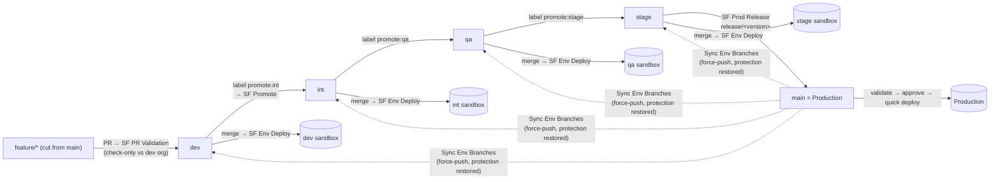
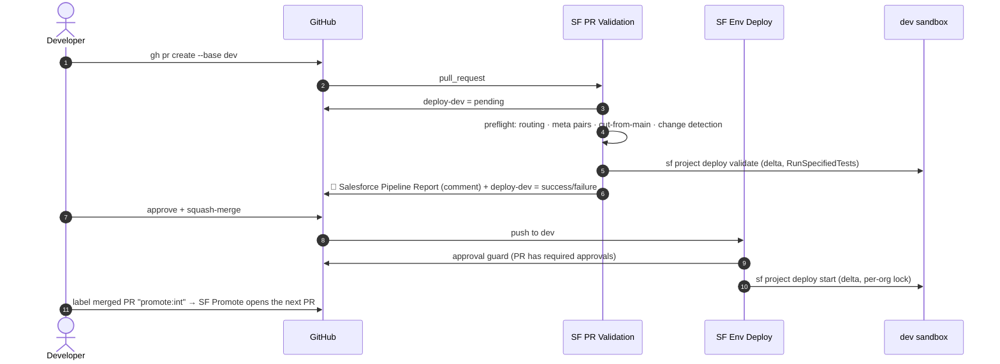
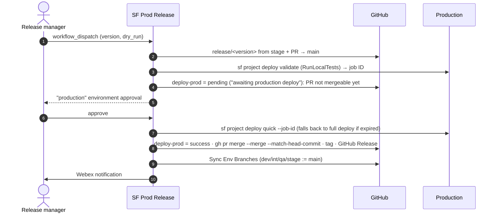

# Salesforce DevOps Pipeline: Overview & Setup

A config-driven CI/CD pipeline for Salesforce on GitHub Actions. Everything lives
in this repository: metadata (`force-app/`), one config file
(`sf-pipeline/pipeline.config.yml`), local composite actions, workflows and Python
helpers. No org name, branch, path, secret name or coverage number is hardcoded
outside the config file.

- [1. Branching & environment model](#1-branching--environment-model)
- [2. Flow](#2-flow)
- [3. Repository layout](#3-repository-layout)
- [4. The config file](#4-the-config-file)
- [5. Composite actions](#5-composite-actions)
- [6. Workflows](#6-workflows)
- [7. Python helpers](#7-python-helpers)
- [8. Guardrails](#8-guardrails)
- [9. Setup, step by step](#9-setup-step-by-step)
- [10. Day-to-day runbook](#10-day-to-day-runbook)
- [11. Troubleshooting](#11-troubleshooting)
- [12. Design notes](#12-design-notes)

---

## 1. Branching & environment model

| Env (`environments.*`) | Branch | Org alias | Sandbox | Status check | Test policy |
|---|---|---|---|---|---|
| `dev`   | `dev`   | `dev`   | dev sandbox   | `deploy-dev`   | specified |
| `int`   | `int`   | `int`   | int sandbox   | `deploy-int`   | specified |
| `qa`    | `qa`    | `qa`    | qa sandbox    | `deploy-qa`    | specified |
| `stage` | `stage` | `stage` | stage sandbox | `deploy-stage` | specified |
| `prod`  | `main`  | `prod`  | Production    | `deploy-prod`  | local (RunLocalTests) |

- **Long-lived branches:** `dev → int → qa → stage → main` (`promotion.chain`). `main` *is* production.
- **Feature branches are always cut from `main`.** PRs enter at the first env in the chain (`dev`):
  `gh pr create --base dev`. Later environments only accept promotion PRs.
- **Promotion is label-driven.** Label a merged PR `promote:int` (then `promote:qa`, `promote:stage`).
  SF Promote opens a PR from `promote/<env>/pr-<n>`, pinned to the original head SHA. Because the
  feature was cut from `main`, that SHA applies cleanly to every env branch.
- **Squash merges into env branches** (enforced by `required_linear_history`). The release PR into
  `main` uses a **merge commit** so SHAs are preserved.
- **Delta model:** every validation/deploy computes
  `sf sgd source delta --from <merge-base(origin/main, HEAD)> --to HEAD`. The merge-base is the
  production baseline the change was cut from, so changes that landed on `main` later never show
  up as phantom reverts. Every environment gets the identical prod-relative artifact, and only the
  delta (`package.xml` + `destructiveChanges.xml`) is ever deployed, never the full org.
- **After every prod release** env branches are force-synced back to `main` so future diffs start
  clean. Branch protection is snapshotted, lifted, and restored exactly (restore always runs).

> Want PRs to enter at `int` instead of `dev`? Change the order of `promotion.chain` (or remove `dev`).
> Nothing else changes.

## 2. Flow



### A PR, end to end



### A production release



## 3. Repository layout

```text
.github/
  actions/
    load-config/action.yml    # Python + PyYAML; resolve pipeline.config.yml for one env → JSON
    sf-setup/action.yml       # sf CLI + sfdx-git-delta (cached) + JWT auth
    deploy/action.yml         # delta → package.xml → test level → validate/deploy/quick → report
    notify/action.yml         # Webex incoming-webhook message
  workflows/
    sf-pr-validation.yml      # PR check-only validate + report comment + deploy-<env> gate
    sf-env-deploy.yml         # real delta deploy to dev/int/qa/stage on merge or deploy:<env> label
    sf-promote.yml            # promote:<env> label → next promotion PR (dev→int→qa→stage)
    sf-prod-release.yml       # assemble → validate prod → approve → deploy → merge/tag/release → sync → notify
    sync-env-branches.yml     # realign env branches to the prod baseline (protection snapshot/restore)
sf-pipeline/
  pipeline.config.yml         # single source of truth
  scripts/
    pipeline_config.py        # load/validate/query the config
    specified_tests.py        # resolve Apex tests from the delta package.xml; track untested classes
    deploy_report.py          # sf deploy --json → Markdown report + coverage gate
    preflight.py              # meta pairs, cut-from-main, PR routing
    gh_helpers.py             # PR comment upsert, commit statuses, approval guard
    branch_protection.py      # snapshot / lift / restore / apply branch protection
    requirements.txt          # pyyaml
  tests/test_pipeline.py      # unit tests for every script
force-app/main/default/       # Salesforce metadata
sfdx-project.json  .forceignore  .gitattributes  .gitignore
docs/PIPELINE_OVERVIEW.md
```

`sf-env-deploy.yml` deploys every non-production env, so it's named for that rather than for `int`.

## 4. The config file

`sf-pipeline/pipeline.config.yml` drives everything. Validate after any edit:

```bash
python sf-pipeline/scripts/pipeline_config.py validate
```

| Key | Purpose |
|---|---|
| `project.source_path` | Package directory (`force-app`); must match `sfdx-project.json`. |
| `project.baseline_branch` | Production baseline (`main`). Deltas start at `merge-base(origin/main, HEAD)`. |
| `quality.coverage_threshold` | % every changed Apex class/trigger must reach (85). A changed class no test executes counts as 0%. |
| `quality.coverage_exempt` | Classes with no executable lines to skip in the gate (interfaces and enums are detected automatically). |
| `tests.require_companion` | Fail fast when changed Apex has no test class (never falls back to RunLocalTests). |
| `tests.class_patterns` / `trigger_patterns` | Companion test names: `{name}Test`, `{name}_Test`, `{base}TriggerHandlerTest`, … |
| `tests.overrides` | Explicit `Class: [TestA, TestB]` mappings. |
| `deploy.wait_minutes`, `delta_output_dir`, `ignore_warnings` | sf deploy options. |
| `tooling.*` | Node, sf CLI and sfdx-git-delta versions (pinned; part of the cache key). |
| `github.pat_secret` | Name of the PAT secret (promotion/release PRs, branch protection). |
| `github.status_check_app_id` | Source allowed to post `deploy-<env>` statuses (-1 = any). |
| `github.labels.*` | `promote:` / `deploy:` label prefixes. |
| `promotion.chain` | Env order; `chain[0]` is the PR entry point, the last entry is production. |
| `promotion.enforce_order` | Only promotion PRs for the next env are accepted past `chain[0]`. |
| `release.*` | Source env (`stage`), branch/tag prefixes, quick deploy on/off. |
| `notifications.webex.*` | `enabled` + the secret holding the incoming-webhook URL. |
| `environments.<env>` | `branch`, `org_alias`, `instance_url`, `secrets.{username,consumer_key,jwt_key}`, `status_check`, `test_policy`, `canary_tests`, `required_approvals`, `github_environment`, `validation_environment` (prod), `sync_after_release`, `production`. |

**Test policies**

| Policy | Test level |
|---|---|
| `specified` | `RunSpecifiedTests` with the companions of changed classes/triggers (plus changed test classes); `NoTestRun` when the delta has no Apex. |
| `local` | `RunLocalTests` (production default). |
| `canary` | `RunSpecifiedTests` with companions **plus** `canary_tests` (a smoke suite that always runs). |
| `none` | `NoTestRun` (sandboxes only). |

In every policy except `none`, changed Apex without a companion test fails the run before anything is
deployed. A synthetic deploy result renders the error in the PR report. Production never receives
`NoTestRun`: a production delta without Apex runs `RunLocalTests` instead.

## 5. Composite actions

All are referenced locally (`uses: ./.github/actions/<name>`), so the repo must be checked out first.

| Action | What it does |
|---|---|
| **load-config** | Sets up Python 3.12 + PyYAML and runs `pipeline_config.py env` for an env (by key, branch, label or `production`). Outputs `found`, `env`, `matched-by`, and `json` (the flat env + globals view; read fields with `fromJSON(...).org_alias`). |
| **sf-setup** | Installs `@salesforce/cli` and `sfdx-git-delta` at the configured versions into a cached prefix (`~/.sf-cli`, `~/.local/share/sf`). It allow-lists the unsigned sgd plugin instead of piping `y`, writes the JWT key to a `chmod 600` temp file, runs `sf org login jwt`, and deletes the key file. Accepts PEM keys raw, with literal `\n`, or base64-encoded. Names any missing secret in the error. |
| **deploy** | The core. Fetches `origin/<baseline>`, computes the merge-base, and runs `sf sgd source delta` to build `package.xml` + `destructiveChanges.xml`. Resolves the test level (`specified_tests.py`), then runs: **validate**: `sf project deploy validate` (or `deploy start --dry-run` when the level is `NoTestRun`, which `validate` rejects); **deploy**: `sf project deploy start`; **quick**: `sf project deploy quick --job-id`. Always renders the report into the job summary, the PR comment (upserted by marker) and an artifact. Fails on a deploy failure or a missed coverage gate. |
| **notify** | Posts Markdown to a Webex incoming webhook when enabled; never fails the job. |

## 6. Workflows

### SF PR Validation (`sf-pr-validation.yml`)
Trigger: any PR (`opened`, `synchronize`, `reopened`, base-branch `edited`). Base branches come from config.

1. **plan**: maps the base branch to an env. Skips non-env bases and `release/*` PRs (the release
   workflow owns those), then posts `deploy-<env>` = pending.
2. **preflight**: PR routing rules, meta-pair check, cut-from-main check, and change detection.
   All checks run and report together.
3. **validate**: `sf-setup` + `deploy` (mode `validate`) at the PR **head** SHA. It posts the
   🚀 Salesforce Pipeline Report comment.
4. **gate**: posts `deploy-<env>` = success/failure on the head SHA (the required status check). It
   comments when validation was skipped (no metadata) or preflight failed, and fails the run if red.

New pushes cancel an in-flight validation; title edits never do.

### SF Env Deploy (`sf-env-deploy.yml`)
Trigger: push to an env branch (a merged PR), the `deploy:<env>` label on an open PR (pre-merge test
deploy), or a manual dispatch. Production is excluded. Pushes where the branch equals `main` (the
post-release sync) are skipped.

**approval-guard** requires the PR behind the commit (or the labeled PR) to carry the env's
`required_approvals` from someone other than the author. **deploy** runs `deploy` with mode `deploy`
inside GitHub Environment `sf-<env>` under a per-org concurrency lock, and notifies Webex if it fails
or is cancelled. **remove-label** always takes the `deploy:<env>` label off afterwards, even when the
guard blocked the deploy, so re-adding it re-triggers.

Label and dispatch runs read the config and helper scripts from the default branch, so a PR can't
relax its own approval guard or remap secret names. Push runs read them from the protected env branch.

### SF Promote (`sf-promote.yml`)
Trigger: a PR closed as merged, or labeled after merge (`promote:<env>`), or a manual dispatch
(`pr_number`, `target_env`). It checks the target is the next env in the chain and isn't production.
Then it pins `promote/<env>/pr-<n>` to the original head SHA via the API and opens the PR with the PAT,
so SF PR Validation runs on it. It comments the link on the source PR and can enable auto-squash-merge.
If that promotion PR is already open, the branch is left untouched, so a conflict resolution pushed
to it survives re-runs.

### SF Prod Release (`sf-prod-release.yml`)
Trigger: manual dispatch from `main` (`version`, `dry_run`).

| Job | Does |
|---|---|
| plan | Version (default `YYYY.MM.DD.<run>`), tag must not exist. |
| assemble | `release/<version>` at the tip of `stage` (idempotent), changelog, PR into `main` (PAT). |
| validate | Check-only validate vs production (`test_policy`) inside the `production-validate` environment. Sets `deploy-prod` to **pending** ("awaiting production deploy"), or failure, so nobody can merge the release PR before production has it. |
| deploy | Waits for **production** environment approval. Quick-deploys the validated job ID; if Salesforce no longer accepts it, falls back (with a warning) to a full deploy of the same artifact and test level. Holds the prod org lock. |
| finalize | Sets `deploy-prod` = success, then `gh pr merge --merge --match-head-commit <validated sha>`, then tag + GitHub Release. |
| sync | Calls `sync-env-branches.yml`. |
| notify | Webex summary (success, dry run, or which stage failed). |

Production is deployed before `main` moves, so `main` only ever reflects what's actually in prod.
A dry run leaves the release PR open with `deploy-prod` pending (unmergeable). Re-run with the
**same version** to release it (the branch and PR are reused), or close it.

### Sync Env Branches (`sync-env-branches.yml`)
Trigger: called by the release, or a manual dispatch (`dry_run`). Each env with
`sync_after_release: true` goes through these steps in a matrix:

1. **Inspect.** Lists commits whose patches aren't in `main` (`git cherry`) in the job summary.
   Those are unreleased changes the sync drops; re-promote them if they're still wanted.
2. **Snapshot** protection (uploaded as an artifact).
3. **Lift** protection.
4. **Force-push with lease** to `main`'s SHA.
5. **Restore** the exact protection and verify it. This always runs.

A missing env branch is created at `main`.

## 7. Python helpers

| Script | Role |
|---|---|
| `pipeline_config.py` | `validate`, `env`, `envs`, `promote-plan`, `get`. Validates types, uniqueness, chain completeness, that exactly one env is production on the baseline branch, and the `sfdx-project.json` path. |
| `specified_tests.py` | Reads the delta `package.xml` and indexes `.cls`/`.trigger` files. A class counts as a test when `@isTest` precedes its declaration; comments and strings are ignored. Maps changed classes to companions via patterns/overrides, applies the env's test policy, records untested classes, and writes the synthetic failure result. |
| `deploy_report.py` | Renders the report: outcome, delta range, test level, component failures, test failures + stack traces, a per-class coverage table vs the threshold, Salesforce coverage warnings, untested classes and the delta manifest. When there are no structured failures it shows a top-level message (auth errors, timeouts, CLI errors). Outputs `status`, `passed`, `coverage_ok`, `job_id`, `overall_coverage`, `marker`. |
| `preflight.py` | `meta-pairs`, `branch-origin`, `pr-route` (see Guardrails). |
| `gh_helpers.py` | `upsert-comment`, `set-status`, `pr-for-commit`, `require-approvals`. Standard library only. |
| `branch_protection.py` | `snapshot`, `lift`, `restore` (GET→PUT conversion incl. signatures + verification), `apply` (standard protection from config), `show`. |

Run the tests: `python -m unittest discover -s sf-pipeline/tests -v`.

## 8. Guardrails

- **Required status check `deploy-<env>`** on every env branch, `enforce_admins: true`, PR reviews
  (`required_approvals`), conversation resolution, no force pushes/deletions, linear history (squash)
  on non-production branches. Apply with `branch_protection.py apply --all`.
- **Meta-pair preflight:** every `.cls/.trigger/.page/.component` needs its `-meta.xml`, and vice versa.
- **Cut-from-main preflight:** a PR may not carry commits that exist only on another env branch
  (e.g. a feature branched off `int`). Commits already in the PR's target are allowed, so merging the
  target into a promotion branch to resolve a conflict is fine there.
- **PR routing:** features enter at `chain[0]`, later envs accept only `promote/<env>/…`,
  `main` accepts only `release/*`, and env branches are never merged into each other.
- **Fail-fast tests:** changed Apex without a test class stops the run and never falls back to
  RunLocalTests.
- **Coverage gate:** every changed class/trigger must reach `coverage_threshold`. One that the tests
  never executed counts as 0%; interfaces, enums and `quality.coverage_exempt` are skipped.
- **Approval guard** before real deploys (PR approvals for sandboxes, GitHub Environment reviewers for prod).
- **Concurrency:** one branch deploy at a time per org (`sf-org-<alias>`). GitHub keeps one *pending*
  run per group, and a newer one replaces it. That's safe because branch deploys are cumulative
  (`merge-base..HEAD`), so the newest includes the older. `deploy:<env>` label runs use their own group
  (`sf-org-<alias>-pr-<n>`) so they never cancel a branch deploy, and Salesforce serializes the
  org's deploy queue. Cancelled deploys notify Webex. Releases and syncs are one at a time; PR
  validations cancel superseded runs.

## 9. Setup, step by step

Prerequisites: admin on the GitHub repo, the System Administrator role in production,
[GitHub CLI](https://cli.github.com/), OpenSSL, Python 3.12+ and `pip install -r sf-pipeline/scripts/requirements.txt`.

### 9.1 Commit the pipeline to `main`
The workflows run from the branches they live on, so get this scaffolding onto `main` first (before `main` is protected).

### 9.2 Create the sandboxes
In production: **Setup → Sandboxes → New Sandbox**, one per env. Names must match how you log in
(sandbox usernames become `user@company.com.<sandboxname>`).

| Sandbox | Suggested type |
|---|---|
| `dev` | Developer Pro |
| `int` | Developer Pro |
| `qa` | Partial Copy |
| `stage` | Full (closest to production) |

Create the Connected App (9.4) in production **before** creating or refreshing sandboxes, so each copy inherits it.

### 9.3 Integration user + certificate
1. Create a dedicated integration user in production (System Administrator profile, or a permission set with
   *API Enabled*, *Modify Metadata Through Metadata API Functions*, *Author Apex* and *Customize Application*).
   Sandboxes copy it as `<username>.<sandboxname>`.
2. Generate the JWT key pair (keep `server.key` out of git; `.gitignore` already blocks `*.key`):

   ```bash
   openssl req -x509 -sha256 -nodes -days 730 -newkey rsa:2048 -keyout server.key -out server.crt -subj "/CN=sf-pipeline"
   ```

### 9.4 Connected App (JWT bearer flow)
**Setup → App Manager → New Connected App.** On orgs where new Connected Apps are disabled, use
**External Client App Manager → New External Client App**; the settings are the same.

1. Enable OAuth Settings; callback URL `http://localhost:1717/OauthRedirect`.
2. **Use digital signatures** → upload `server.crt` (for an External Client App: *Enable JWT Bearer Flow* + upload).
3. Scopes: *Manage user data via APIs (api)*, *Perform requests at any time (refresh_token, offline_access)*.
4. Save, then **Manage → Edit Policies → Permitted Users: Admin approved users are pre-authorized**.
5. **Manage Profiles / Permission Sets** → add the integration user's profile or permission set.
6. Copy the **Consumer Key** (Manage Consumer Details).
7. In each sandbox, confirm the app exists (it's copied from production on create/refresh) and pre-authorize
   the sandbox integration user the same way. The consumer key is the same unless you create separate apps.

Check each org locally before wiring CI:

```bash
sf org login jwt --client-id <CONSUMER_KEY> --jwt-key-file server.key --username ci.user@company.com.int --instance-url https://test.salesforce.com --alias int
```

### 9.5 GitHub secrets
Names come from `environments.<env>.secrets` and `github.pat_secret`:

| Secret | Value |
|---|---|
| `SF_DEV_USERNAME` … `SF_PROD_USERNAME` | Integration username per org |
| `SF_DEV_CONSUMER_KEY` … `SF_PROD_CONSUMER_KEY` | Connected App consumer key per org |
| `SF_DEV_JWT_KEY` … `SF_PROD_JWT_KEY` | Contents of `server.key` (PEM; base64 also accepted) |
| `SF_PIPELINE_PAT` | Fine-grained PAT for this repo only: **Contents**, **Pull requests**, **Workflows**, **Administration** = read/write |
| `WEBEX_WEBHOOK_URL` | Webex incoming-webhook URL (only if `notifications.webex.enabled: true`) |

**Sandbox secrets go at repository level.** PR validation runs outside GitHub Environments, so it
can't see environment-scoped secrets:

```bash
REPO=muraliseelam/salesforce-devops-actions
for ENV in DEV INT QA STAGE; do
  gh secret set "SF_${ENV}_JWT_KEY" --repo "$REPO" < server.key
  gh secret set "SF_${ENV}_CONSUMER_KEY" --repo "$REPO" --body "<consumer key>"
done
gh secret set SF_STAGE_USERNAME --repo "$REPO" --body "ci.user@company.com.stage"
gh secret set SF_QA_USERNAME    --repo "$REPO" --body "ci.user@company.com.qa"
gh secret set SF_INT_USERNAME   --repo "$REPO" --body "ci.user@company.com.int"
gh secret set SF_DEV_USERNAME   --repo "$REPO" --body "ci.user@company.com.dev"
gh secret set SF_PIPELINE_PAT   --repo "$REPO"          # paste the PAT when prompted
```

**Production secrets go in the two production environments** (create them first, §9.8). Only the
release workflow, running from protected `main`, can then read production credentials. No PR or
feature-branch workflow can:

```bash
for GHENV in production-validate production; do
  gh secret set SF_PROD_JWT_KEY      --repo "$REPO" --env "$GHENV" < server.key
  gh secret set SF_PROD_CONSUMER_KEY --repo "$REPO" --env "$GHENV" --body "<consumer key>"
  gh secret set SF_PROD_USERNAME     --repo "$REPO" --env "$GHENV" --body "ci.user@company.com"
done
```

Repository-level `SF_PROD_*` secrets also work, but then any workflow on any branch can read them.

### 9.6 Environment branches

```bash
git fetch origin
for b in dev int qa stage; do git push origin "origin/main:refs/heads/$b"; done
```

### 9.7 Repository settings

```bash
gh api -X PATCH repos/muraliseelam/salesforce-devops-actions \
  -F allow_squash_merge=true -F allow_merge_commit=true -F allow_rebase_merge=false \
  -F allow_auto_merge=true -F delete_branch_on_merge=true
```

- Squash is what env branches accept; the merge commit is used only by the release PR into `main`.
- `delete_branch_on_merge` is safe: promotion pins branches to the original head SHA through the API.

### 9.8 GitHub Environments (approval guard for production)
Deploy jobs reference `sf-dev`, `sf-int`, `sf-qa`, `sf-stage` (`github_environment`), plus
`production-validate` (`validation_environment`, the release's check-only validation) and
`production` (the release deploy). GitHub creates missing ones on first use. Set up the two
production environments explicitly. Both are restricted to protected branches, and only
**production** has required reviewers. That's the approval guard for the real deploy.

```bash
REPO=muraliseelam/salesforce-devops-actions
ME=$(gh api user --jq .id)
gh api -X PUT "repos/$REPO/environments/production-validate" --input - <<EOF
{"deployment_branch_policy":{"protected_branches":true,"custom_branch_policies":false}}
EOF
gh api -X PUT "repos/$REPO/environments/production" --input - <<EOF
{"reviewers":[{"type":"User","id":$ME}],
 "deployment_branch_policy":{"protected_branches":true,"custom_branch_policies":false}}
EOF
```

You can create these at any time, but protected-only environments accept deploys only after `main` is protected (§9.9).
Leave the sandbox environments without a branch policy: the `deploy:<env>` label deploys from PR refs.

### 9.9 Branch protection

```bash
python sf-pipeline/scripts/branch_protection.py apply --all     # uses your gh login (repo admin)
python sf-pipeline/scripts/branch_protection.py show --branch int
```

Each branch requires `deploy-<env>` and gets `enforce_admins: true`, `required_approvals` reviews,
conversation resolution, and no force pushes/deletions. Non-production branches also get linear
history (squash merges). `main` requires 0 reviews because the production environment is its
approval and the release job does the merge.

### 9.10 Smoke test
1. `git switch -c feature/smoke origin/main`
2. Add `force-app/main/default/classes/PipelineSmoke.cls` (+ `-meta.xml`) and `PipelineSmokeTest.cls` (+ `-meta.xml`).
3. `gh pr create --base dev --fill`. Expect the report comment with `RunSpecifiedTests: PipelineSmokeTest` and `deploy-dev` ✅.
4. Remove the test class and push. Expect the fail-fast *Missing Apex test* error.
5. Restore it, approve, squash-merge → SF Env Deploy deploys to the dev org.
6. Label the merged PR `promote:int` → a `[promote → int]` PR appears and validates against int.

## 10. Day-to-day runbook

| I want to… | Do this |
|---|---|
| Ship a change | Branch from `main` → PR to `dev` → green report + approval → squash-merge (auto-deploys dev). |
| Promote it | Label the merged PR `promote:int`; then label that PR `promote:qa`, then `promote:stage`. |
| Test-deploy before merging | Label the open PR `deploy:<env>` (needs approvals; label is removed afterwards). |
| Redeploy an env | Actions → SF Env Deploy → Run workflow → `environment`. |
| Release to production | Actions → SF Prod Release → Run workflow (from `main`); optional `dry_run` first. Approve the *production* deployment when prompted. |
| Map a class to a non-standard test | Add it under `tests.overrides`. |
| Change coverage, orgs, branches, tests | Edit `pipeline.config.yml` → `pipeline_config.py validate`. |

## 11. Troubleshooting

| Symptom | Cause / fix |
|---|---|
| *Missing Apex test (ApexClass X)* | No `XTest`/`X_Test`/… `@isTest` class in `force-app`. Add one or map it in `tests.overrides`. |
| *Coverage gate* ❌ in an otherwise green validation | A changed class is below `coverage_threshold`; the table shows which. |
| *Branch origin check* | The branch carries commits from an env branch. Recreate it from `main` and cherry-pick your commits. |
| *PR routing* | Feature PRs go to `dev`; later envs only take `promote/<env>/…` PRs created by SF Promote. |
| `JWT login failed: user hasn't approved this consumer` | The integration user's profile/permission set isn't on the Connected App, or policies aren't "Admin approved users are pre-authorized". |
| `invalid_grant … audience` | `instance_url` is wrong for the org: `https://test.salesforce.com` (or the sandbox My Domain) for sandboxes, `https://login.salesforce.com` (or My Domain) for production. |
| Missing GitHub secrets for org 'X' | The secret named in `environments.X.secrets` isn't set at repository level. |
| Quick deploy warning in a release | The validation expired (10 days) or production changed since; the job re-deployed the same artifact in full. |
| *Protection NOT restored* | Download the `branch-protection-<env>` artifact and run `branch_protection.py restore --branch <b> --snapshot <file>`. |
| Merge blocked on `deploy-<env>` "Expected" | Validation hasn't run for the head SHA. Push a commit, or close and reopen the PR. |
| Release PR shows `deploy-prod` pending | Expected until the production deploy finishes; SF Prod Release merges it itself. After a dry run, re-run with the same version. |
| A `deploy:<env>` run didn't happen | The label is removed after every run (even a blocked one). Fix the cause (e.g. approvals) and add the label again. |

## 12. Design notes

- **Merge-base, not tip-of-main.** `--from origin/main` would show anything merged into `main` after the
  branch was cut as a revert. The merge-base (equivalent to sgd's `--merge-base`) is the real prod
  baseline of the change.
- **PR head, not the merge ref.** Validation checks out the PR head SHA, so the artifact is
  identical whichever env the PR targets.
- **Commit statuses as the required check.** The `deploy-<env>` context comes from config and can be
  posted on any SHA. The release workflow uses that to satisfy `main`'s protection on the release head.
- **`NoTestRun` validations** use `sf project deploy start --dry-run`, because `deploy validate` accepts only
  RunSpecifiedTests/RunLocalTests/RunAllTestsInOrg/RunRelevantTests.
- **Deploy before merge for production**, so `main` never claims something production doesn't have.
- **Sync drops unreleased work by design.** After a release every env restarts from `main`. The sync
  summary lists commits whose changes weren't released, so they can be re-promoted.
- **Fork PRs** don't receive secrets, so their validation fails at authentication. This pipeline assumes
  contributors push branches to this repository.
- **Trust boundary.** Anyone who can push a branch can change workflow files on it, so repository
  secrets are reachable by every writer. That's why production credentials live only in environments
  restricted to protected branches (§9.5/9.8), and why label deploys take their approval rules and
  secret-name mapping from the default branch.
